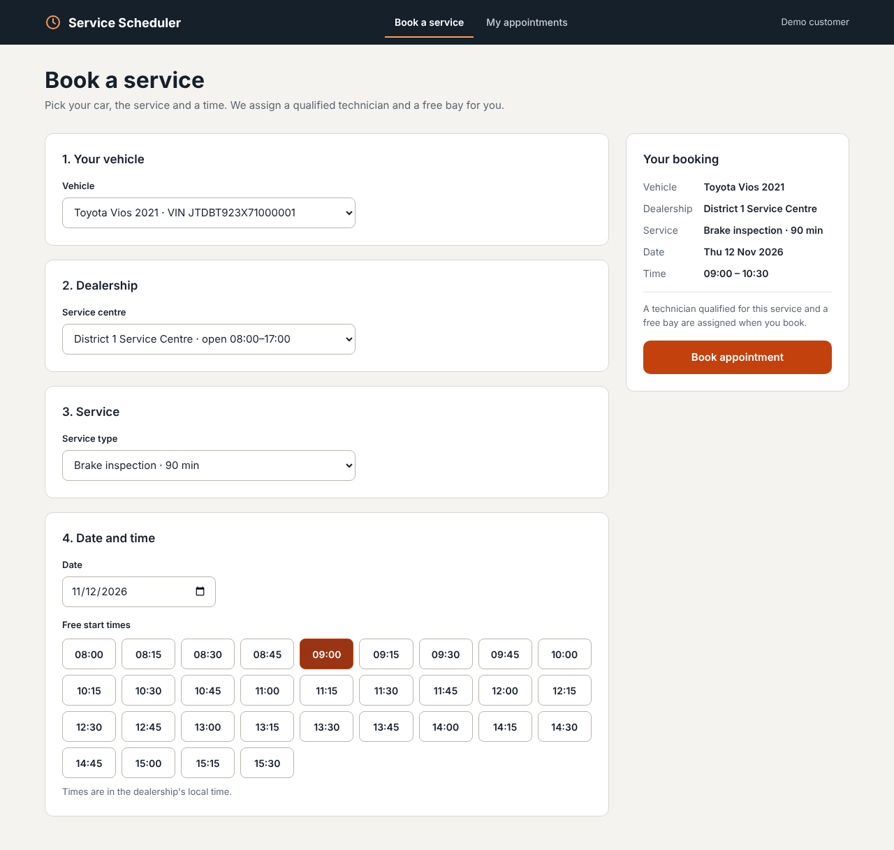
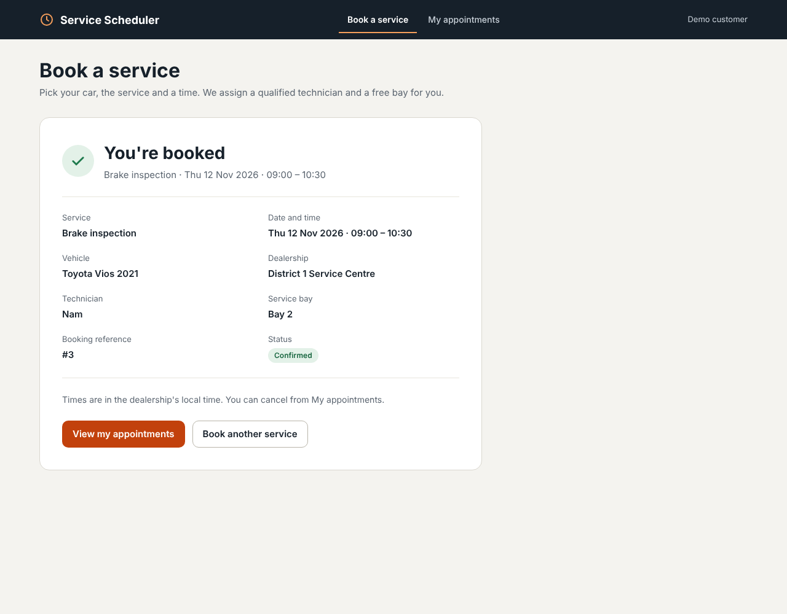
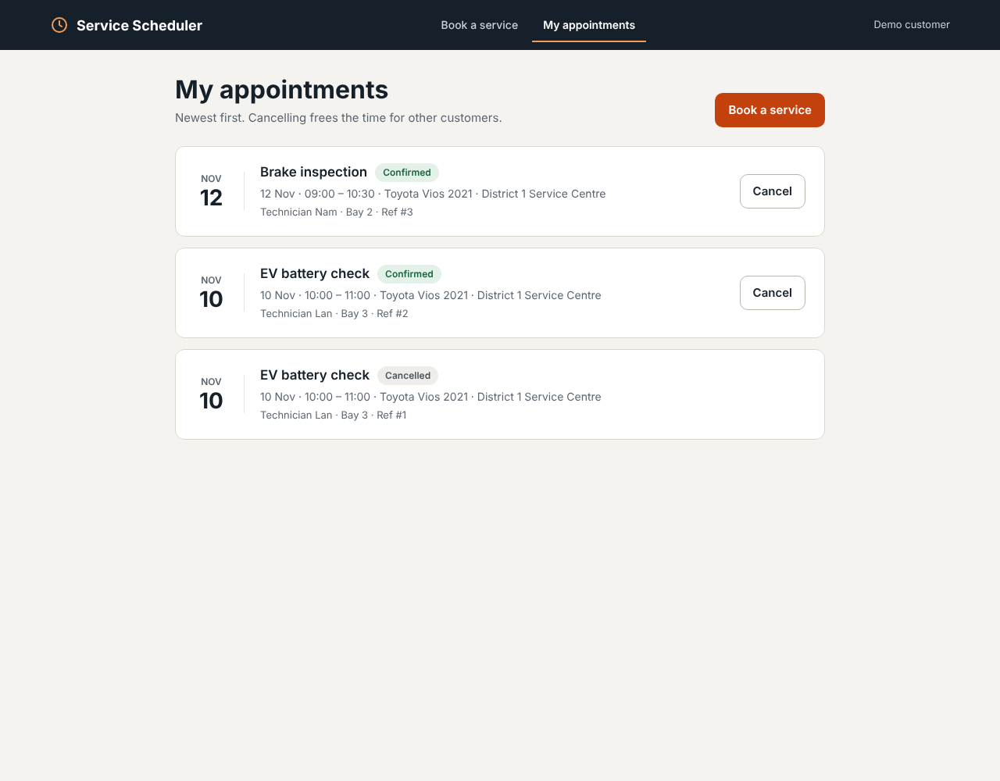
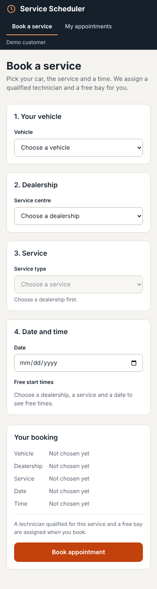
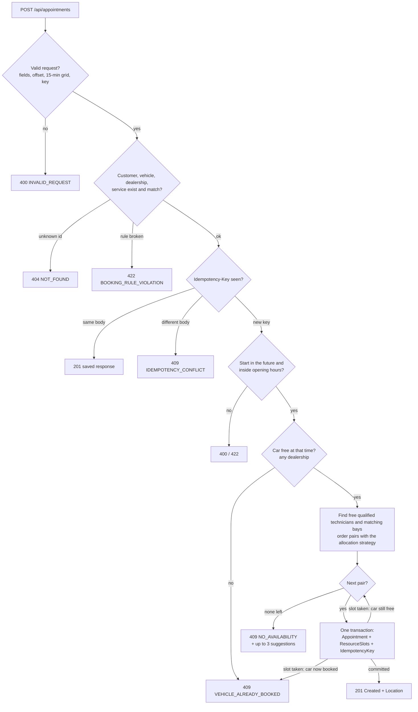

# Unified Service Scheduler

A small web app for booking a car service. The customer picks a vehicle, a dealership, a service and a start time.
The system finds a qualified technician and a free service bay for the **whole** job and saves the appointment.
Double booking is impossible, even when many people book the same time at the same second: the database blocks it.

Built for the Keyloop technical assignment (Scenario A) with .NET 8, EF Core, SQL Server, React and TypeScript.

| Book a service | Booking confirmed |
|---|---|
|  |  |

| My appointments | Mobile |
|---|---|
|  |  |

## Contents

1. [How to run](#1-how-to-run)
2. [Walkthrough with curl](#2-walkthrough-with-curl)
3. [API endpoints and error codes](#3-api-endpoints-and-error-codes)
4. [How double booking is prevented](#4-how-double-booking-is-prevented)
5. [Architecture](#5-architecture)
6. [What each test proves](#6-what-each-test-proves)
7. [Design decisions, trade-offs and assumptions](#7-design-decisions-trade-offs-and-assumptions)
8. [How I used AI](#8-how-i-used-ai)
9. [What I would do next](#9-what-i-would-do-next)

---

## 1. How to run

You need **Docker**. To run without Docker you also need the **.NET 8 SDK** and **Node.js 20+**.

### a) Everything with Docker Compose (easiest)

```bash
cp .env.example .env          # then set MSSQL_SA_PASSWORD in .env
docker compose up --build
```
PowerShell: `Copy-Item .env.example .env`

| What | URL |
|---|---|
| Web app | http://localhost:3000 |
| API | http://localhost:5080 |
| Swagger | http://localhost:5080/swagger |
| Health | http://localhost:5080/health/live, http://localhost:5080/health/ready |

The API applies the database migrations and seed data when it starts. Stop with `Ctrl+C`; remove the database with `docker compose down -v`.

Quick check once it is up (book, replay the same key, conflict, cancel):

```bash
./scripts/smoke-test.sh                                        # bash (needs curl + jq)
powershell -ExecutionPolicy Bypass -File scripts/smoke-test.ps1   # Windows
```

### b) Locally, without Docker for the app

Start only SQL Server in Docker, then run the API and the web app on your machine.

```bash
cp .env.example .env
docker compose up -d db                       # SQL Server on localhost:1433

dotnet run --project backend/src/Scheduler.Api   # API on http://localhost:5080 (Development: migrates + seeds, Swagger on)

cd frontend
npm ci
npm run dev                                   # web on http://localhost:5173
```

The API reads `ConnectionStrings:Scheduler` from `backend/src/Scheduler.Api/appsettings.json`. Its password matches
`.env.example`. If you changed the password, override it:

```bash
# bash
export ConnectionStrings__Scheduler="Server=localhost,1433;Database=Scheduler;User Id=sa;Password=<yours>;TrustServerCertificate=True"
```
```powershell
# PowerShell (Windows, untested)
$env:ConnectionStrings__Scheduler = "Server=localhost,1433;Database=Scheduler;User Id=sa;Password=<yours>;TrustServerCertificate=True"
```

The web app calls `VITE_API_BASE_URL` (default `http://localhost:5080`).

**No Docker at all (Windows, SQL Server LocalDB).** LocalDB ships with Visual Studio ("Data storage and processing"
workload) or the SQL Server Express installer. Point the API at it; on first start it creates the database, runs the
migrations and loads the seed data:

```powershell
sqllocaldb start MSSQLLocalDB
$env:ConnectionStrings__Scheduler = "Server=(localdb)\MSSQLLocalDB;Database=Scheduler;Trusted_Connection=True;TrustServerCertificate=True"
dotnet run --project backend/src/Scheduler.Api
```

Then start the web app as above. For SQL Server Express use `Server=localhost\SQLEXPRESS;...` instead.
To start again from an empty database: `cd backend; dotnet tool restore; dotnet ef database drop --project src/Scheduler.Infrastructure`
(it uses the same environment variable). Without Docker you can run the Domain, Application, Architecture and frontend
tests; the integration tests need Docker.

Visual Studio / Rider users can run the requests in [`backend/src/Scheduler.Api/Scheduler.Api.http`](backend/src/Scheduler.Api/Scheduler.Api.http).

### c) Run the tests

```bash
# Backend: all projects (Domain, Application, Architecture, Integration)
dotnet test backend/Scheduler.sln

# Only the fast unit tests (no Docker needed)
dotnet test backend/tests/Scheduler.Domain.Tests
dotnet test backend/tests/Scheduler.Application.Tests
dotnet test backend/tests/Scheduler.ArchitectureTests

# Integration tests start a real SQL Server in Docker (Testcontainers). Docker must be running.
dotnet test backend/tests/Scheduler.IntegrationTests

# Frontend
cd frontend
npm ci
npm test -- --run
```

If your network blocks Docker Hub, Testcontainers cannot pull its helper ("Ryuk") image. Turn it off:
`export TESTCONTAINERS_RYUK_DISABLED=true` (PowerShell: `$env:TESTCONTAINERS_RYUK_DISABLED = "true"`).
The SQL Server image itself comes from `mcr.microsoft.com`.

---

### d) Browser-only live preview

`cd frontend && npm run build:preview` builds `frontend/dist-preview/index.html`: one self-contained file that runs the
real React app against a simulated API in the browser (same seed data and booking rules as the backend, demo data kept
in the browser). Useful for a quick look without .NET or SQL Server; it is a demo, not the real backend.

Click **Play the demo** in the top banner for a hands-free tour (about 40 seconds). It drives the real screens like a
person would: it books an EV battery check (the system assigns Lan and the EV bay), starts a second booking while a
simulated other customer takes the same time (409 with suggested times, then booking a suggestion), and cancels the
first booking with the confirm step. **Stop** ends it at any point; **Replay** runs it again from fresh data.

## 2. Walkthrough with curl

These are **real responses** from a run of the API with the seed data, captured with `DAY=2026-11-10`
(long JSON is trimmed with `…`). Pick any future date for `DAY`. Your ids, `createdUtc` and `traceId` will differ.

Dealership 1 is "District 1 Service Centre", open 08:00–17:00 in `Asia/Ho_Chi_Minh` (UTC+7).
Service type 2 is "Brake inspection": 90 minutes, needs the Brakes skill at Qualified or higher and a Lift bay.
Times you send have an offset (`+07:00`); times you get back are UTC (`Z`). So 13:00 local is `06:00Z`.

```bash
DAY=2026-11-10              # pick any future date
API=http://localhost:5080
```
The keys below contain `$DAY`, so you can run the walkthrough again with another date on the same database.

<details>
<summary>PowerShell (Windows, untested)</summary>

```powershell
$DAY = "2026-11-10"         # pick any future date
$API = "http://localhost:5080"
Invoke-RestMethod "$API/api/dealerships/1/availability?serviceTypeId=2&date=$DAY"
$body = @{ customerId = 1; vehicleId = 1; dealershipId = 1; serviceTypeId = 2; startTime = "${DAY}T13:00:00+07:00" } | ConvertTo-Json
Invoke-RestMethod -Method Post "$API/api/appointments" -ContentType "application/json" `
  -Headers @{ "Idempotency-Key" = "demo-$DAY-1" } -Body $body
```
For the other steps, change the body and the key the same way, or use the `.http` file or Swagger.
</details>

**1. Free start times for a brake inspection on that day**

```bash
curl "$API/api/dealerships/1/availability?serviceTypeId=2&date=$DAY"
```
```json
{
  "dealershipId": 1, "serviceTypeId": 2, "date": "2026-11-10",
  "timeZoneId": "Asia/Ho_Chi_Minh", "durationMinutes": 90,
  "slots": [
    { "startUtc": "2026-11-10T01:00:00Z", "endUtc": "2026-11-10T02:30:00Z" },
    { "startUtc": "2026-11-10T01:15:00Z", "endUtc": "2026-11-10T02:45:00Z" },
    …
    { "startUtc": "2026-11-10T08:30:00Z", "endUtc": "2026-11-10T10:00:00Z" }
  ]
}
```
31 start times: 08:00 to 15:30 local. The last one ends exactly at closing time.

**2. Book 13:00 local → `201 Created`**

```bash
curl -i -X POST "$API/api/appointments" \
  -H "Content-Type: application/json" -H "Idempotency-Key: demo-$DAY-1" \
  -d '{"customerId":1,"vehicleId":1,"dealershipId":1,"serviceTypeId":2,"startTime":"'"$DAY"'T13:00:00+07:00"}'
```
```http
HTTP/1.1 201 Created
Location: /api/appointments/1
```
```json
{
  "id": 1,
  "status": "Confirmed",
  "startUtc": "2026-11-10T06:00:00Z",
  "endUtc": "2026-11-10T07:30:00Z",
  "createdUtc": "2026-11-01T15:59:28.757324Z",
  "customerId": 1,
  "vehicle": { "id": 1, "make": "Toyota", "model": "Vios", "year": 2021, "vin": "JTDBT923X71000001" },
  "dealership": { "id": 1, "name": "District 1 Service Centre", "timeZoneId": "Asia/Ho_Chi_Minh" },
  "serviceType": { "id": 2, "name": "Brake inspection", "durationMinutes": 90 },
  "technician": { "id": 3, "name": "Minh" },
  "serviceBay": { "id": 2, "name": "Bay 2", "bayType": "Lift" }
}
```
The system chose **Minh** (Brakes: Qualified) instead of Nam (Brakes: Senior), to keep the more senior and more
widely skilled technician free. At 09:00 it would choose Nam, because Minh starts at 12:00.

**3. Send the same request again (same key, same body) → the same `201`, no second booking**

```http
HTTP/1.1 201 Created
Location: /api/appointments/1
```
The body is identical to step 2 (`"id": 1`, same `createdUtc`).

**4. Same time, another car, new key → `409 NO_AVAILABILITY` with suggestions**

The only active Lift bay (Bay 2) is now busy from 13:00 to 14:30.
```bash
curl -X POST "$API/api/appointments" \
  -H "Content-Type: application/json" -H "Idempotency-Key: demo-$DAY-2" \
  -d '{"customerId":1,"vehicleId":2,"dealershipId":1,"serviceTypeId":2,"startTime":"'"$DAY"'T13:00:00+07:00"}'
```
```json
{
  "type": "https://tools.ietf.org/html/rfc9110#section-15.5.10",
  "title": "No availability",
  "status": 409,
  "detail": "No technician and bay are free for the whole time you picked.",
  "instance": "/api/appointments",
  "code": "NO_AVAILABILITY",
  "traceId": "00-d9d2cf53ecbe8ea6fda231326b76cfc2-561e11c4d19f357e-00",
  "suggestedStartTimes": [
    "2026-11-10T04:15:00Z",
    "2026-11-10T04:30:00Z",
    "2026-11-10T07:30:00Z"
  ]
}
```
These are the three free start times nearest to 13:00 (11:15, 11:30 and 14:30 local), sorted by time. Suggestions also skip times when the customer's car is booked elsewhere.
11:30 and 14:30 are both 90 minutes away; 11:15 beats 14:45 because on a tie the earlier time wins.

**5. The same car at another dealership at the same time → `409 VEHICLE_ALREADY_BOOKED`**

Thu Duc (dealership 2) has a free technician and bay, but car 1 is already booked at District 1.
```bash
curl -X POST "$API/api/appointments" \
  -H "Content-Type: application/json" -H "Idempotency-Key: demo-$DAY-3" \
  -d '{"customerId":1,"vehicleId":1,"dealershipId":2,"serviceTypeId":5,"startTime":"'"$DAY"'T13:00:00+07:00"}'
```
```json
{
  "title": "Vehicle already booked",
  "status": 409,
  "detail": "This vehicle already has a booking at that time.",
  "code": "VEHICLE_ALREADY_BOOKED",
  …
}
```

**6. Old key, different body → `409 IDEMPOTENCY_CONFLICT`**

```bash
curl -X POST "$API/api/appointments" \
  -H "Content-Type: application/json" -H "Idempotency-Key: demo-$DAY-1" \
  -d '{"customerId":1,"vehicleId":1,"dealershipId":1,"serviceTypeId":2,"startTime":"'"$DAY"'T14:00:00+07:00"}'
```
```json
{
  "title": "Idempotency conflict",
  "status": 409,
  "detail": "This Idempotency-Key was already used with a different request body.",
  "code": "IDEMPOTENCY_CONFLICT",
  …
}
```

**7. Ends after closing time (16:00 + 90 min = 17:30) → `422 BOOKING_RULE_VIOLATION`**

```bash
curl -X POST "$API/api/appointments" \
  -H "Content-Type: application/json" -H "Idempotency-Key: demo-$DAY-4" \
  -d '{"customerId":1,"vehicleId":2,"dealershipId":1,"serviceTypeId":2,"startTime":"'"$DAY"'T16:00:00+07:00"}'
```
```json
{
  "title": "Booking rule violation",
  "status": 422,
  "detail": "The appointment must be inside the dealership opening hours.",
  "code": "BOOKING_RULE_VIOLATION",
  …
}
```

**8. Not on the 15-minute grid (10:10) → `400 INVALID_REQUEST`**

```bash
curl -X POST "$API/api/appointments" \
  -H "Content-Type: application/json" -H "Idempotency-Key: demo-$DAY-5" \
  -d '{"customerId":1,"vehicleId":2,"dealershipId":1,"serviceTypeId":2,"startTime":"'"$DAY"'T10:10:00+07:00"}'
```
```json
{
  "title": "Invalid request",
  "status": 400,
  "detail": "startTime must be on the 15-minute grid (:00, :15, :30 or :45, with zero seconds).",
  "code": "INVALID_REQUEST",
  "errors": {
    "startTime": [ "startTime must be on the 15-minute grid (:00, :15, :30 or :45, with zero seconds)." ]
  },
  …
}
```

**9. Cancel (use the id from step 2) → `200 OK`**

```bash
curl -X POST "$API/api/appointments/1/cancel"
```
```json
{ "id": 1, "status": "Cancelled", "startUtc": "2026-11-10T06:00:00Z", "endUtc": "2026-11-10T07:30:00Z", … }
```
The appointment row stays (history). Its slot rows (technician, bay and car) are deleted, so the time is free again.
Cancelling only works before the appointment starts.

**10. Cancel again → `409 APPOINTMENT_NOT_CANCELLABLE`**

```json
{
  "title": "Appointment cannot be cancelled",
  "status": 409,
  "detail": "Only confirmed appointments can be cancelled. This appointment is Cancelled.",
  "code": "APPOINTMENT_NOT_CANCELLABLE",
  …
}
```

**11. Book the freed time again with a new key → `201 Created`**

```bash
curl -i -X POST "$API/api/appointments" \
  -H "Content-Type: application/json" -H "Idempotency-Key: demo-$DAY-6" \
  -d '{"customerId":1,"vehicleId":1,"dealershipId":1,"serviceTypeId":2,"startTime":"'"$DAY"'T13:00:00+07:00"}'
```
```http
HTTP/1.1 201 Created
Location: /api/appointments/2
```
```json
{ "id": 2, "status": "Confirmed", "startUtc": "2026-11-10T06:00:00Z", "endUtc": "2026-11-10T07:30:00Z", … ,
  "technician": { "id": 3, "name": "Minh" }, "serviceBay": { "id": 2, "name": "Bay 2", "bayType": "Lift" } }
```
After this booking, availability for that day shows 20 start times instead of 31.

> On Windows, use the PowerShell block above, the `.http` file or Swagger. Plain `curl` in PowerShell is an alias
> for `Invoke-WebRequest`; use `curl.exe` if you want the commands above.

---

## 3. API endpoints and error codes

JSON is camelCase and enums are strings. Response times are UTC ISO-8601 with `Z`. The booking `startTime` must
have an offset (a value without one is rejected, never read as server local time).

| Method | Path | What it does | Responses |
|---|---|---|---|
| GET | `/api/dealerships` | Active dealerships with local opening hours | 200 |
| GET | `/api/service-types?dealershipId={id}` | Active service types (filter is optional) | 200, 400 |
| GET | `/api/customers/{id}/vehicles` | A customer's vehicles | 200, 404 |
| GET | `/api/dealerships/{id}/availability?serviceTypeId=&date=YYYY-MM-DD` | Free start times on that local day, ascending. Reserves nothing | 200, 400, 404, 422 |
| POST | `/api/appointments` (header `Idempotency-Key`, required, max 100) | Book. The system picks technician and bay; the car must be free | 201 + `Location`, 400, 404, 409, 422, 503 |
| GET | `/api/appointments?customerId={id}` | A customer's appointments, newest first (`[]` for an unknown customer) | 200, 400 |
| GET | `/api/appointments/{id}` | One appointment with technician and bay | 200, 404 |
| POST | `/api/appointments/{id}/cancel` | Cancel before it starts and free the slots | 200, 404, 409, 503 |
| GET | `/health/live` | The process is running | 200 |
| GET | `/health/ready` | SQL Server can be reached | 200, 503 |

Every error is an RFC 7807 ProblemDetails (`application/problem+json`) with these extra fields:
`code` (stable, for the frontend to react to), `traceId`, `errors` (field → messages, when there are field errors)
and `suggestedStartTimes` (for `NO_AVAILABILITY`).

| code | HTTP | Retry? | Meaning |
|---|---|---|---|
| `INVALID_REQUEST` | 400 | No | Missing field or Idempotency-Key, bad format, no offset, not on the 15-minute grid, start in the past, year outside 2000–9998 |
| `INVALID_REQUEST` | 405 | No | Wrong HTTP method for the path |
| `INVALID_REQUEST` | 415 | No | Body is not `application/json` |
| `NOT_FOUND` | 404 | No | Unknown customer, vehicle, dealership, service type, appointment or route |
| `BOOKING_RULE_VIOLATION` | 422 | No | Vehicle not owned by the customer, inactive dealership or service, service not offered there, outside opening hours |
| `NO_AVAILABILITY` | 409 | No | Valid request, but no technician + bay pair is free; has up to 3 `suggestedStartTimes` |
| `IDEMPOTENCY_CONFLICT` | 409 | No | Same Idempotency-Key with a different request body |
| `VEHICLE_ALREADY_BOOKED` | 409 | No | The car already has a booking that overlaps this time (at any dealership); no suggestions |
| `APPOINTMENT_NOT_CANCELLABLE` | 409 | No | Cancel on an appointment that is not Confirmed, or that has already started |
| `DATABASE_BUSY` | 503 | **Yes** | Database busy (deadlock/timeout) even after one retry. Has `Retry-After: 1`. Retry with the same key |
| `INTERNAL_ERROR` | 500 | No | Unexpected bug. Details only in Development |

Swagger (Development, or `Swagger:Enabled=true`) shows every endpoint with its summary, responses, the
Idempotency-Key header and this error table.

---

## 4. How double booking is prevented

**The database is the judge.** Time is cut into 15-minute slots. A booking writes one row per slot for the technician,
one for the bay and one for the **car** into `ResourceSlots`, which has this unique index:

```sql
CREATE UNIQUE INDEX UX_ResourceSlots_Resource_Slot ON ResourceSlots (ResourceType, ResourceId, SlotStartUtc);
```

A 90-minute job writes 6 + 6 + 6 = 18 rows in the **same transaction** as the appointment (and the idempotency key).
If any slot is already taken, SQL Server rejects the insert with error 2601/2627 and the whole transaction rolls back.
Two bookings that overlap by even 15 minutes cannot both commit, whatever the application code does.

**Try the next pair.** The handler builds a list of candidate (technician, bay) pairs and tries them in order.
"Slot taken" is not a failure of the request: it only means someone else won that pair a moment ago, so we try the
next one. Only when every pair fails do we answer `409 NO_AVAILABILITY` with nearby free times.

**The car is reserved too.** Before trying pairs, the handler checks that the car has no booking in that time
(at any dealership); if it has, the answer is `409 VEHICLE_ALREADY_BOOKED`. If two bookings of the same car race,
the car's slot rows make one of them fail; on "slot taken" the handler checks the car again and stops with
`VEHICLE_ALREADY_BOOKED` instead of trying more pairs. (If the winner was a retry with the same Idempotency-Key,
the saved response is returned instead.)

**Availability is only a hint.** The free-times list and the candidate list are read without locks and can be out of
date a millisecond later. That is fine, because the unique index makes the final decision when we save.



A deadlock or timeout retries the whole attempt once; if it fails again the answer is `503 DATABASE_BUSY`.

This is proven by `ConcurrencyApiTests.Twenty_parallel_bookings_of_the_same_slot_give_exactly_one_201_and_nineteen_409`:
20 parallel requests (20 different cars) for the same EV battery check (only one technician and one bay can do it)
give exactly one 201, nineteen 409 `NO_AVAILABILITY`, one appointment row and 12 slot rows.
`VehicleApiTests.Ten_parallel_bookings_of_the_same_vehicle_at_different_dealerships_give_one_201_and_nine_409`
does the same for one car booked at several dealerships at once: one 201 and nine `VEHICLE_ALREADY_BOOKED`.

---

## 5. Architecture

Clean Architecture with four backend projects. Each layer only depends on the layers inside it.
Architecture tests check these rules on every test run.

| Layer | What it holds | Depends on |
|---|---|---|
| **Domain** | Entities (`Appointment`, `Technician`, …), `TimeRange`, `SlotGrid`, domain errors | nothing |
| **Application** | Use cases (commands, queries, handlers), validators, DTOs, interfaces (`IAppointmentRepository`, `IClock`, …), allocation strategy | Domain |
| **Infrastructure** | `SchedulerDbContext`, EF configurations, migrations, seed data, repositories, SQL error mapping, `SystemClock` | Application, Domain |
| **Api** | Controllers, ProblemDetails mapping, middleware, health checks, Swagger, `Program.cs` | Application, Infrastructure (DI wiring only) |

```
backend/
  src/
    Scheduler.Domain/          Entities/  ValueObjects/ (TimeRange, SlotGrid)  Enums/  Errors/
    Scheduler.Application/     Abstractions/  Allocation/  Appointments/{Book,Cancel,Queries,Dtos}  Catalog/  Common/
    Scheduler.Infrastructure/  Persistence/ (DbContext, Configurations, Migrations)  Repositories/  Seeding/  Time/
    Scheduler.Api/             Controllers/  Http/  Middleware/  Swagger/  Program.cs  Dockerfile  Scheduler.Api.http
  tests/
    Scheduler.Domain.Tests/  Scheduler.Application.Tests/  Scheduler.ArchitectureTests/  Scheduler.IntegrationTests/
frontend/
  src/api/ (apiClient, appointmentsApi, types)   src/features/booking/   src/features/appointments/
  src/components/ (Button, Select, Alert, …)     src/lib/ (date and format helpers)
docs/  SPEC.md (design and spec)  design/  screenshots/
```

### SOLID

| Principle | Where |
|---|---|
| **S** – one job per class | `BookAppointmentHandler` only runs the use case; `BookAppointmentValidator` checks the request shape; `SlotGrid` does slot math; `SqlErrorClassifier` maps SQL errors; controllers only turn HTTP into commands and `ApiProblems` turns errors into HTTP |
| **O** – extend without editing | A new allocation rule is a new `IResourceAllocationStrategy`; `BookAppointmentHandler` and `DaySchedule` do not change |
| **L** – implementations are swappable | Every strategy must return all valid pairs, only reordered (tested in `ScarcityAwareStrategyTests` and `LeastQualifiedFirstStrategyTests`); `FakeClock` / `FixedClock` replace `SystemClock` in tests |
| **I** – small interfaces | `IAppointmentRepository`, `ITechnicianRepository`, `IServiceBayRepository`, `IDealershipRepository`, `IServiceTypeRepository`, `IVehicleRepository`, `ICustomerRepository`, `IIdempotencyStore`, `IUnitOfWork`, `IClock` |
| **D** – depend on abstractions | Application defines the interfaces, Infrastructure implements them with EF Core; handlers never see `DbContext`; wiring in `Program.cs` via `AddApplication()` and `AddInfrastructure()` |

### Design patterns

| # | Pattern | Where (real names) | Why |
|---|---|---|---|
| 1 | Clean Architecture | the four projects; enforced by `LayerTests` | Business rules stay apart from EF Core and HTTP |
| 2 | Command / Handler (light CQRS) | `BookAppointmentCommand` + `BookAppointmentHandler`, `CancelAppointmentCommand` + `CancelAppointmentHandler`; queries such as `GetAvailabilityHandler` in `Appointments/Queries` | One small class per use case; reads and writes kept apart |
| 3 | Repository | `IAppointmentRepository` → `AppointmentRepository`, and the catalog repositories | Hides EF Core; the one place that turns 2601/2627 into `RepositoryErrors.SlotTaken` |
| 4 | Unit of Work | `IUnitOfWork` → `UnitOfWork`; the transaction inside `AppointmentRepository.TryAddWithSlotsAsync` | Appointment, slots and idempotency key are saved together or not at all |
| 5 | Strategy | `IResourceAllocationStrategy` → `ScarcityAwareStrategy` (default), `LeastQualifiedFirstStrategy` (alternative) | How we pick technician and bay is a business choice that can change; switching is one DI line, the handler never changes (Open/Closed) |
| 6 | Factory Method | `Appointment.Create(...)`, `ResourceSlot.For(...)` | An appointment can only exist in a valid state |
| 7 | Value Object | `TimeRange` (with the grid rules in `SlotGrid`) | Overlap, contains and slot splitting live in one tested place |
| 8 | Result | `Result<T>`, `Error`; mapped by `ResultExtensions.ToActionResult` and `ApiProblems` | "No availability" is a normal answer, not an exception |
| 9 | Idempotent Receiver | `Idempotency-Key` header, `BookingRequestHash`, `IdempotencyEntry`, `IIdempotencyStore`, `IdempotencyKeys` table | A double click or network retry returns the same booking |
| 10 | Chain of Responsibility | `ExceptionHandlingMiddleware` → `StatusCodeProblems` (status code pages) → MVC | Every error leaves the API in the same ProblemDetails shape |
| 11 | Dependency Injection | `Program.cs`, `AddApplication()`, `AddInfrastructure()` | Connects interfaces to implementations; tests swap in fakes |

Frontend: **custom hooks** (`useAvailability`, `useBookAppointment`, `useAppointments`, `useCancelAppointment`) hold the
data logic and components only render; **Adapter** (`api/appointmentsApi.ts`) turns API JSON into typed UI objects.

**Patterns deliberately not used:** MediatR (hand-written handlers are enough), a generic `Repository<T>` (it hides
useful EF features), AutoMapper (mapping is short and explicit by hand), event sourcing and a message bus (too heavy
for this size).

---

## 6. What each test proves

| Level | Project | Tests | What it proves |
|---|---|---|---|
| Domain unit | `Scheduler.Domain.Tests` | 97 | `TimeRange` overlap (touching = no overlap, inside, crossing, identical); `SlotGrid` grid check, rounding, `Split` (60 min → 4 slots, 90 → 6); `Appointment.Create` rules, snapshots and slot rows for technician, bay and car; `Cancel` only from Confirmed and only before the start; an unknown stored time zone is broken data (not a client error); tier order and `IsQualifiedFor`; shifts and opening hours checked in local time (ending exactly at close is allowed, one minute later is not) |
| Application unit | `Scheduler.Application.Tests` | 132 | Scarcity-aware technician choice (oil change at 10:00 → Nam, so Lan, the only EV technician, stays free for an EV check; Brake inspection: Minh at 13:00, Nam at 09:00); each ordering rule in isolation; inactive, unqualified, off-shift and wrong-bay resources skipped; next pair tried on SlotTaken; 409 with ≤ 3 nearest suggestions; idempotent replay and conflict, including a replay after the start time passed and a same-key race; car already booked → `VEHICLE_ALREADY_BOOKED` (pre-check and a twin booking that wins during the save); validator rules incl. the technical year bound; opening hours → 422; transient error retried once then 503; cancel paths. Uses hand-written fakes and `FakeClock` |
| Architecture | `Scheduler.ArchitectureTests` | 6 | Domain depends on nothing else (and only on base-library assemblies); Application never references EF Core, Infrastructure or Api; Infrastructure never references Api; entities have no public setters |
| Integration – persistence | `Scheduler.IntegrationTests` (Persistence, Repositories) | 24 | On a real SQL Server (Testcontainers): migration and seed data, the unique slot index rejects overlaps (touching jobs are fine), cancel frees slots, SlotTaken / IdempotencyKeyTaken / transient error mapping, rowversion conflict on a double cancel, a 10-way repository race with exactly one success |
| Integration – API | `Scheduler.IntegrationTests` (Api) | 70 | Full HTTP API with `WebApplicationFactory` on the real database: catalog, availability, book → 201 + Location, scarcity-aware allocation end-to-end, cancel then rebook, cancel after the start → 409, same car at two dealerships → 409, year 9999 → 400 (not 500), broken time zone data → 500, 400/404/405/415/422 shapes, idempotency, `NO_AVAILABILITY` suggestions, CORS, health, Swagger |
| **Concurrency** | Api | (in the 69) | **`Twenty_parallel_bookings_of_the_same_slot_give_exactly_one_201_and_nineteen_409`**: 20 different cars, exactly 1 × 201, 19 × 409, 1 appointment row and 12 slot rows. `Ten_parallel_bookings_of_the_same_vehicle_at_different_dealerships_give_one_201_and_nine_409`: 1 × 201, 9 × `VEHICLE_ALREADY_BOOKED`. `Ten_parallel_retries_with_the_same_key_and_body_all_get_the_same_appointment`: all 201 with the same id, 1 row |
| Frontend | `frontend` (Vitest + React Testing Library) | 42 | Booking form validation; free times shown in dealership time; Book disabled while saving; 409 shows suggested times that can be clicked; 503 and network errors show Try again; cancel only on Confirmed and the list refreshes; the API adapter turns ProblemDetails into typed errors; time-zone helpers (5 test files) |

Total: 97 + 132 + 6 + 94 + 42 = **371 tests**.

---

## 7. Design decisions, trade-offs and assumptions

| Decision | Why | Trade-off |
|---|---|---|
| **Unique slot rows instead of row locking** | The database blocks overlaps even if a code path has a bug; no lock ordering, so fewer deadlocks | Start times must be on a 15-minute grid; more rows (one per slot per resource) |
| **No MediatR** | Fewer dependencies; handlers are plain classes, easy to read | No pipeline behaviours (we do not need them) |
| **Availability is a hint, not a promise** | Reading without locks is fast and simple | The list can change a second later; the booking call is the real check and answers 409 with suggestions |
| **Idempotency with a request hash** | SHA-256 over a fixed order of the five fields, with `startTime` turned into UTC (so `13:00+07:00` and `06:00Z` are the same request). The saved response is returned on a replay, even after the start time has passed | A key reused with a different body is an error (409), not a new booking |
| **Scarcity-aware allocation** | Technicians who are the only one able to do another of the dealership's services are tried last, so specialists stay free (counted over all active technicians, not only free ones). Then whoever can do fewer other services, then the lowest tier in the required skill, then fewest confirmed jobs that day, then lowest id. It only reorders: if the specialist is the only one free, they still get the job | A first version used "least qualified first"; an independent review showed it could use up the only EV technician on an oil change. Kept as `LeastQualifiedFirstStrategy` to show the strategy is swappable. Not a global optimiser: it decides one booking at a time |
| **UTC in the database, dealership time zone for rules** | All instants are stored as UTC; opening hours and shifts are local times checked in the dealership's IANA time zone (`Asia/Ho_Chi_Minh`) | Every input needs an offset; the UI shows times in the dealership zone |
| **Rule snapshots on the appointment** | Duration, required skill and bay type are copied at booking time, so later changes to a service do not rewrite history | A few extra columns |
| **System always picks technician and bay** | Owner decision; makes double-booking logic simpler and fairer | The customer cannot ask for a person |
| **The car is a reserved resource** | Owner decision: one car cannot be serviced in two places at once. It uses the same unique slot rows as technicians and bays, so the database also blocks a double booking of the car | One more slot row per 15 minutes; a booking for a busy car is rejected even at another dealership |
| **Cancel only before the start** | Owner decision: a job that has started or passed is history, not something to cancel | No way to mark a no-show yet (would be a new status) |
| **Technical date bound (years 2000–9998)** | Dates far outside this range would overflow the time math and crash; they get `400 INVALID_REQUEST` instead | Not a business booking horizon; it only stops nonsense input |
| **Broken server data is a 500** | A dealership with an unknown time zone id is a data problem, not the client's mistake, so it is `500 INTERNAL_ERROR` (input checks still give 400) | — |

**Assumptions** (from the plan): one job needs exactly one technician and one bay; durations are multiples of 15 minutes
(otherwise rounded up); shifts are the same every day (no holidays or leave); a job may not cross local midnight;
no login, one demo customer (id 1). Out of scope: login, notifications, rescheduling, multi-technician jobs, payment.

---

## 8. How I used AI

<!-- TODO(owner): review and rewrite in your own words -->

*Draft – to be rewritten by the owner.*

- I brainstormed the design and the build plan with Claude: the problem, the data model, the unique-slot idea and the phases.
- I then used **Claude Code as an orchestrator**. It coordinated separate agents for the frontend, the backend and
  the database, all working against one shared spec (`docs/SPEC.md`).
- The orchestrator reviewed each phase and re-ran the tests before accepting it.
- I made the product decisions (for example: no login, the system always assigns the technician and bay, the plan
  wins over the UI design when they differ).

---

## 9. What I would do next

- **Rescheduling** an appointment (move it in one transaction: free old slots, take new ones).
- An optional **`latestFinish` window** on the request, so the system books the earliest free time in the window instead of answering 409.
- **Notifications** (email/SMS) on booking and cancel.
- **Login and accounts** instead of the demo customer.
- **Holidays, leave and special opening hours** for dealerships and technicians.
- **Jobs that need more than one technician** or more than one bay.
- **Observability**: structured logs, metrics (bookings, 409 rate, retries) and tracing.
