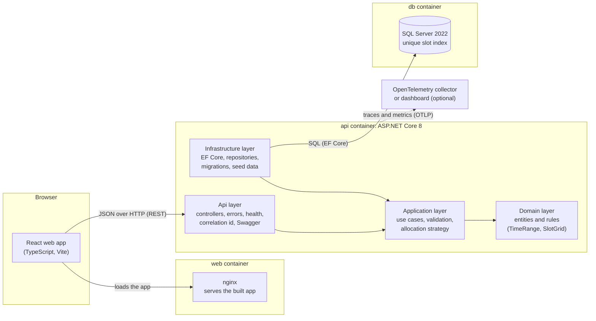
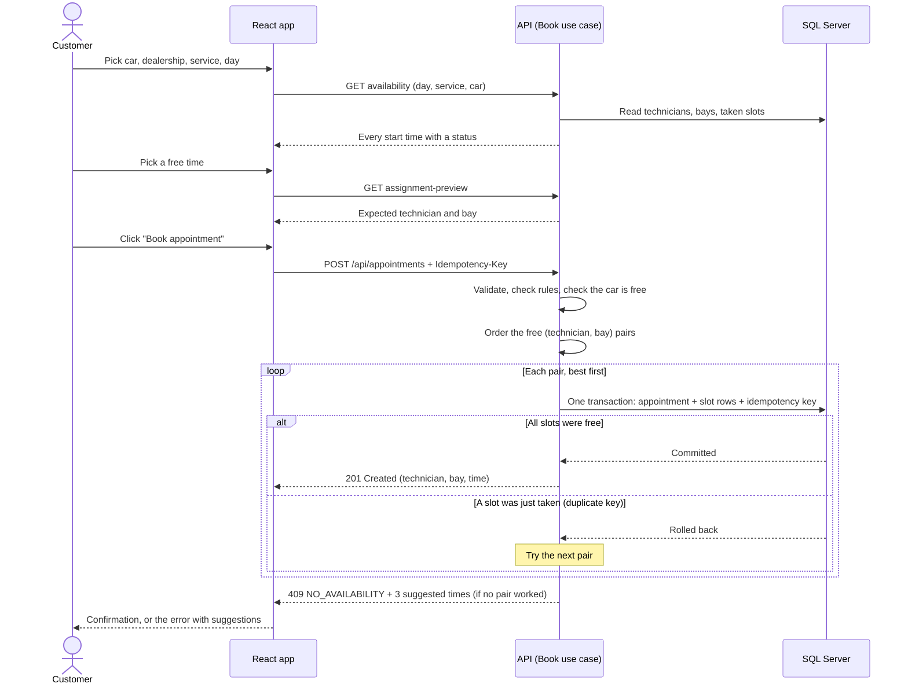
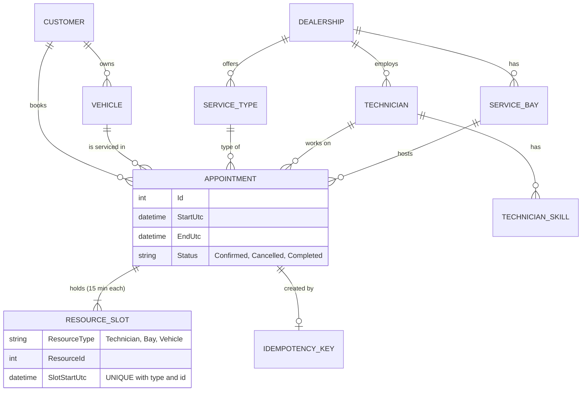

# System Design: Unified Service Scheduler (Scenario A)

This document explains how the system is built and why. It covers the six parts the challenge asks for:

1. [Architecture diagram](#1-architecture-diagram)
2. [What each component does](#2-what-each-component-does)
3. [How data flows](#3-how-data-flows)
4. [Technologies and why we chose them](#4-technologies-and-why-we-chose-them)
5. [Observability strategy](#5-observability-strategy)
6. [How GenAI helped in the design phase](#6-how-genai-helped-in-the-design-phase)

It also covers [scalability, performance and reliability](#7-scalability-performance-and-reliability),
[security](#8-security-and-privacy), [assumptions](#9-assumptions) and [trade-offs](#10-trade-offs-and-what-comes-next).

Other documents:
- `README.md`: how to build, run and test the app, and the AI Collaboration Narrative.
- `docs/SPEC.md`: the detailed rules and the full API contract. Code comments point to its sections ("SPEC section 5").

---

## 0. The problem in one paragraph

A dealership books service jobs by hand today. We want a customer to choose a **car**, a **service** (for example an
oil change), a **dealership** and a **start time**. Before we confirm, we must check that **one qualified technician**
and **one suitable service bay** are both free for the **whole job**. If they are, we save an **Appointment** that links
the customer, the car, the technician and the bay. Two people must never get the same technician or bay at the same
time, even if they click "Book" at the same moment.

**What we built:** both layers. A REST API with a real SQL Server database (the main part), and a React web app that
shows the full customer journey. There is also a browser-only live preview that runs the same React app against a
simulated API, so anyone can try it without installing anything.

---

## 1. Architecture diagram

The arrows inside the API container show **code dependencies**. The Domain depends on nothing. Infrastructure
implements interfaces that the Application layer defines. Architecture tests check these rules on every test run.

Everything runs with one command: `docker compose up --build`. There are three containers: `db`, `api` and `web`.

---

## 2. What each component does

| Component | Its job |
|---|---|
| **React web app** | The customer journey: pick who is booking, the car, the dealership, the service, a day in the calendar and a free time, then book. It shows who is expected to serve you, the booking result, and a list of your appointments with Cancel. It never decides anything important; the API does. A "Dealership setup" tab shows the technicians, bays and services the system books with. |
| **nginx (web container)** | Serves the built React files. Nothing else. |
| **Api layer** | The HTTP edge. Controllers turn requests into use-case calls and results into HTTP responses. Every error becomes the same JSON shape (ProblemDetails) with a stable `code`. It also adds the correlation id, health checks and Swagger. |
| **Application layer** | The use cases: *book*, *cancel*, *list appointments*, *availability*, *days for the calendar*, *assignment preview*. It validates input, runs the business steps and chooses the technician and bay with the **allocation strategy**. It only talks to the database through interfaces. |
| **Domain layer** | The core rules with no outside dependencies: an appointment, a time range, the 15-minute grid, "is this technician qualified", "does this bay match", "can this appointment be cancelled". |
| **Infrastructure layer** | EF Core and SQL Server: the database context, table mappings, migrations, seed data, repositories, and turning SQL errors (for example "duplicate key") into clear results. |
| **SQL Server** | Stores all data. Its **unique index** on time slots is the final guard against double booking. |
| **Live preview** (extra) | A single HTML page with the real React app and an in-browser copy of the API rules. It has a one-click guided demo. Parity tests keep its rules equal to the real API. |

---

## 3. How data flows

### 3.1 Booking an appointment

**The key idea: the database is the judge.** Time is cut into 15-minute slots. A 60-minute job writes 4 slot rows
for the technician, 4 for the bay and 4 for the car. The table has a unique index on
`(ResourceType, ResourceId, SlotStartUtc)`. If two bookings overlap by even 15 minutes, SQL Server rejects the second
one, so they can never both be saved. The availability screens are only a hint; the unique index makes the final
decision. A test sends 20 bookings for the same slot at the same moment: exactly 1 succeeds and 19 get 409.

**Other steps in the flow:**
- **Idempotency.** The app sends a new `Idempotency-Key` with each booking attempt. If the same request arrives twice
  (double click, network retry), the API returns the first result and does not book twice.
- **Choosing the technician.** The default strategy keeps scarce specialists free. Example: Lan is the only EV
  technician, so an oil change goes to Nam and Lan stays free for EV jobs. The strategy only changes the **order**
  of the candidates; if Lan is the only one free, she still gets the job.
- **Errors.** Each error has a stable code, for example `NO_AVAILABILITY`, `VEHICLE_ALREADY_BOOKED` or
  `DATABASE_BUSY`, so the app can react without reading the text.

### 3.2 Showing availability (calendar and times)

1. When the customer opens a month, the app calls `GET .../availability/days` once for the whole month. The API loads
   all taken slots for that range in **one** query and works out each day in memory. Full and past days are greyed out.
2. When the customer picks a day, the app calls `GET .../availability`. It returns every start time with a status:
   `Available`, `Booked`, `VehicleBooked` (your car is busy then) or `Past`.
3. When the customer picks a time, the app calls `GET .../assignment-preview` to show who will serve them.

All three use **the same rule code as booking**, so the screen and the booking can never disagree. Only a newer
booking by someone else can change the answer, and then the booking returns 409 with suggestions.

### 3.3 Cancelling

`POST /api/appointments/{id}/cancel` marks the appointment `Cancelled` and deletes its slot rows in one transaction.
The technician, bay and car are free again at once. You can only cancel before the start time.

### 3.4 Data model

All times are stored in **UTC**. Each dealership has a time zone (`Asia/Ho_Chi_Minh`), used only for opening hours,
shifts and showing times. The full table list is in `docs/SPEC.md` section 4.

---

## 4. Technologies and why we chose them

| Area | Choice | Why |
|---|---|---|
| API | **ASP.NET Core 8** (controllers) | Long-term support version, fast, and the stack Keyloop uses. Controllers keep each endpoint easy to find and document. |
| Data access | **EF Core 8** + migrations | Typed queries, easy transactions, and migrations that create the schema and seed data on startup. We keep it out of the use cases (repositories), so the business logic is easy to test. |
| Database | **SQL Server 2022** | A real relational database with transactions and unique indexes, which is exactly what we need to block double booking. It is also common in dealership systems. |
| Validation | **FluentValidation** | Clear, testable rules in the Application layer, with field-level messages for 400 errors. |
| API docs | **Swagger / OpenAPI** | A live, clickable API contract at `/swagger`. |
| Observability | **OpenTelemetry** + built-in .NET logging | A vendor-neutral standard: the same code can send data to Jaeger, Grafana, Azure Monitor or Datadog. See section 5. |
| Backend tests | **xUnit, FluentAssertions, Testcontainers, NetArchTest** | Testcontainers starts a **real** SQL Server for integration tests, so the unique-index and concurrency tests prove real behaviour. NetArchTest checks the layer rules. |
| Frontend | **React 18 + TypeScript + Vite** | Type safety from the API types to the screen, a fast dev server, and a small static build. |
| Server state | **TanStack Query** | Caching, refetching and invalidation (for example, refresh free times after a 409) without hand-written state code. |
| Forms | **React Hook Form + Zod** | Simple form state with typed validation rules. |
| Calendar | **react-day-picker 9** | An accessible calendar (keyboard, screen readers) that lets us grey out full days. |
| Frontend tests | **Vitest + React Testing Library** | Tests behave like a user: find by label, click, read the result. |
| Running it | **Docker Compose** | One command starts the database, the API and the web app the same way on every machine. |

**Not used on purpose:** MediatR, AutoMapper and a generic `Repository<T>`. For a project this size they add layers
without adding value. Plain handlers and small mappers are easier to read.

---

## 5. Observability strategy

Goal: when something goes wrong, we can **see it**, **find the exact request**, and **know why**.

### 5.1 What is in the code today

| Signal | What we do | Example use |
|---|---|---|
| **Logs** | Structured logs with .NET logging. JSON lines in containers, readable text in development. Each request has a log scope with the **correlation id** and the **trace id**. | Find every log line of one failed booking. |
| **Correlation id** | The API reads `X-Correlation-Id` from the request (or makes a new one) and returns it in the response. It is also in every error body next to `traceId`. | A customer reports an error; support asks for the id and finds the request. |
| **Traces** | OpenTelemetry tracing for incoming HTTP requests, database calls, and a custom span around the booking use case with the outcome. | See that a slow booking spent its time in SQL, or retried a pair. |
| **Metrics** | OpenTelemetry metrics: built-in HTTP metrics plus our own meter `Scheduler`: `scheduler.bookings` by outcome (created, no_availability, vehicle_already_booked, …), `scheduler.cancellations`, `scheduler.db.retries`, and `scheduler.booking.duration`. | Watch the 409 rate during a busy morning. |
| **Health checks** | `/health/live` (the process runs) and `/health/ready` (SQL Server answers). Docker Compose uses `/health/ready`. | Restart or stop sending traffic when the database is down. |

**What we never log:** customer email, phone or the car's VIN. A test checks this.

**Where the data goes:** by default, logs go to the console and traces and metrics are off. Set
`Observability:Otlp:Endpoint` to send traces and metrics to any OpenTelemetry collector (for example the .NET Aspire
dashboard, Jaeger, or Grafana). `docker-compose.yml` has a commented example with the .NET Aspire dashboard. README section 1e lists the settings.

### 5.2 What we would add in production

- **Dashboards:** bookings per minute, 409 rate by code, p95 booking time, database retries, 5xx rate.
- **Alerts:** many `DATABASE_BUSY` (503) responses, 5xx above 1%, p95 booking time above 1 second, readiness failing.
- **Frontend:** send browser errors and the correlation id of failed calls to the same backend.
- **Sampling:** keep all error traces and a small share of successful ones to control cost.

---

## 6. How GenAI helped in the design phase

I used Claude (chat) to brainstorm before any code was written. GenAI suggested options and explained trade-offs; I
made the decisions.

1. **Understanding the problem.** I asked Claude to explain the core problem in simple English with a concrete
   example (technicians Nam and Lan, Bays 1–3). This became the seed data and the test examples.
2. **Choosing how to block double booking.** Claude listed four options: a PostgreSQL exclusion constraint, a
   **slot table with a unique index**, **row locking** (`UPDLOCK, HOLDLOCK`), and optimistic version checks. I asked
   follow-up questions (why a fixed grid? does a 47-minute job waste time? should we combine two options?). I chose the
   unique slot table on a 15-minute grid because the database itself guarantees correctness, there is less deadlock
   risk, and it is easy to test and explain. Combining options was rejected: it adds the limits of both.
3. **Shaping the API and the scope.** The brainstorm suggested `GET availability`, a 409 with nearby times, an
   `Idempotency-Key`, a cancel endpoint, and a 20-parallel-requests test. I kept these and named the out-of-scope
   items (login, holds, rescheduling, multi-technician jobs).
4. **A written plan before code.** I asked for a build plan in simple English that follows SOLID and lists the design
   patterns with reasons. I reviewed and corrected it. It became `docs/SPEC.md`, the single source the AI agents
   built from.
5. **Design changes after review.** An independent AI review of the first version found gaps. I decided each one:
   treat the car as a reserved resource, protect sole specialists in the allocation strategy, allow cancel only
   before the start, and turn the spec into a design document. One AI proposal for the scarcity rule was wrong; an
   agent flagged it, and I chose the correct rule ("protect sole specialists").

How I used AI during implementation, and how I verified it, is in the README: **AI Collaboration Narrative**.

---

## 7. Scalability, performance and reliability

**Correctness under load.** The unique index blocks double booking whether there is one API instance or ten. The API
keeps no state in memory between requests, so we can run more instances behind a load balancer.

**Performance.**
- Each booking reads only one dealership-day and writes a few small rows in one short transaction.
- The calendar endpoint loads a whole month with one query per resource kind, not one query per day.
- Indexes cover the hot queries (slots by resource and time, appointments by customer).
- The frontend caches catalog data and refetches free times only when needed.

**Reliability.**
- **Idempotency** makes retries safe: the same key never books twice.
- **Transient database errors** (deadlock, timeout) are retried once; then the API answers `503 DATABASE_BUSY`, and the
  client can retry with the same key.
- **Clear failure answers:** every error is ProblemDetails with a stable code; unexpected errors are 500 without
  internal details.
- **Health checks** let Docker or Kubernetes restart the API or hold traffic.

**If traffic grows a lot:**
- Run several API instances; SQL Server stays the single source of truth.
- Partition or archive old slot rows (they are only needed for the future).
- Add a read replica or a short cache for catalog data (dealerships, services).
- For very busy dealerships, a "hold this slot for 5 minutes" step could reduce 409s.

**Maintainability.** Clean Architecture keeps the rules in the Domain and Application layers, which have no database
code. Architecture tests stop layers from mixing. Each use case is one handler. There are 629 automated tests.

---

## 8. Security and privacy

- **No login** in this version (an assumption from the challenge). A "Booking as" switcher picks one of three demo
  customers. In production, the customer id would come from the signed-in user, never from the request body.
- The API checks that the car belongs to the customer before booking.
- CORS allows only the web app's origins.
- Personal data (email, phone, VIN) is never written to logs.
- The database password comes from `.env`, which is not in Git.

---

## 9. Assumptions

The challenge is open in places, so we made these assumptions:
- One job needs exactly one technician and one bay for its whole duration.
- Start times use a 15-minute grid; durations are multiples of 15 minutes.
- Shifts and opening hours are the same every day (no holidays or leave). A job cannot cross midnight.
- The system always picks the technician and bay; the customer cannot choose them, but can see who is expected.
- A car cannot be in two appointments at the same time, even at different dealerships.
- A customer can cancel only before the start time.
- All dealerships in the demo use the `Asia/Ho_Chi_Minh` time zone, but the code supports any IANA time zone.

More details: `docs/SPEC.md` section 0 and README section 7.

---

## 10. Trade-offs and what comes next

| Decision | What we gain | What we give up |
|---|---|---|
| 15-minute slot table + unique index | The database guarantees no double booking; simple, testable | Times must be on a 15-minute grid |
| System assigns technician and bay | Better use of scarce skills; simpler for the customer | The customer cannot ask for a favourite technician |
| Availability is advisory | Fast reads with no locks | A time can be taken between viewing and booking (handled with 409 + suggestions) |
| No login | Faster to build and demo | Not production ready on its own |

**Next steps:** rescheduling in one transaction, holidays and leave, jobs that need two technicians, notifications,
real login, a short "hold" before confirming, and dashboards and alerts on the metrics above.
